# Fizz Level Studio

<p align="center">
  
</p>

<p align="center">
  
  
  
  
</p>

A level and overworld editor for Lieutenant Fizz, built so that a person and Claude can design levels together, with a text language at its heart that anyone can read and write.

## What it is

Fizz Level Studio is the level and overworld editor for Lieutenant Fizz, where a person and Claude (over MCP) design levels together. This folder holds the work so far: the builder language (a text language that compiles to the Rust `Builder` calls in `episodes/episode-1/game/src/levels.rs`), its Rust exporter and the proofs that it rebuilds every Episode 1 level and the overworld exactly, an MCP server for Claude, a copy of the interactive design prototype, and the spec for the real studio. It is a scratch project, not a git repository, and nothing in it touches the game's repository.

**Planned: Fizz 2, the more important target.** A Fizz 2 level belongs to a world project that builds into one world pack, and is written in a dialect of the Fizz 1 script (`script fizz2 0`): a `map` grid, exact `at=` positions, objects with ids, named states that doors, lights and panels bind to and rules change (with `lock` as sugar), placed lights, floating words and sounds raised by rules, and custom enemies and items with behaviour scripts compiled to bytecode. A level's target is fixed when it is created; Fizz 1 levels convert up to Fizz 2 and Fizz 2 levels export down with a lossy check. Fizz 2 levels are edited in the game's own oblique look, Fizz 1's art is a retro set, and a pixel editor paints parallax panels and sprites. Episode 3 is planned as another target profile. None of it is built, and much of it waits on Fizz 2 change requests; see `docs/LANGUAGE.md`, `docs/WORLD.md`, `docs/SCRIPTING.md`, `docs/EDITOR.md` sections 13 to 15, `docs/FIZZ2-COVERAGE.md` and `docs/DECISIONS.md`.

## Getting started

You need [Bun](https://bun.sh) and the Node version in `.node-version`. The studio app itself is not built yet; what runs today is the language package, the MCP server and the proofs against the game.

Install the MCP server's dependencies once with `cd packages/mcp && bun install`. Then:

```bash
bun test packages/language          # 76 unit tests        (bun run test)
bun test packages/mcp               # 21 tests, including a real stdio MCP round trip   (bun run test:mcp)
bash scripts/prove-crater.sh        # crater and kitchen-sink proofs  (bun run prove)
bash scripts/prove-all.sh           # all 16 levels, the overworld, and both rasterisers against the game's data  (bun run prove:all)
bun tools/gen-proto-levels.ts > design/project/levels-data.js   # the prototype's 16 levels and overworld
bun tools/gen-lang-docs.ts > design/project/lang-docs.js        # the prototype's completion data
```

The proofs need Rust and the crates already in the local Cargo cache (`--offline`); they build only inside `scratch/rust/`, and write generated Rust there and the game's data as JSON into `scratch/truth/`.

## What is here

- `packages/language/src/` — `parser.ts` (text to AST with line numbers), `printer.ts` (AST to text; parsed lines print exactly as read), `edits.ts` (`appendEdits`), `rust.ts` (`toRust(ast, fnName)`), `overworld.ts` (overworld parser, rasteriser and `overworldToRust`), `docs.ts` (every word of the language documented, for completion and the manual), `tables.ts` (word tables), `errors.ts`, `args.ts`, `cli.ts`.
- `packages/language/test/` — `bun test` suites for the parser, printer round trip, edits block, error messages, exporter, objects, overworld and docs.
- `packages/mcp/` — the MCP server (below).
- `levels/crater.fizz` — Crater Fields, hand-written, call for call with the real `crater()`.
- `levels/real/*.fizz` — all 16 Episode 1 levels (Crater Fields included), written out as fills from the game's own data by `tools/decompile-level.ts`.
- `overworlds/main.fizz` — the Episode 1 overworld, using paths and scatter.
- `tools/` — proof generators (`gen-all-proof.ts`, `gen-overworld-proof.ts`), verifiers (`verify-rasteriser.ts`, `verify-overworld.ts`), audits (`audit-levels.ts`, `audit-editor.ts`), `decompile-level.ts`, the prototype's data generators (`gen-proto-levels.ts`, `gen-lang-docs.ts`) and `design-harness/`.
- `scratch/rust/` — a copy of the game's `crates/sim` and `episodes/episode-1/game`, where the proofs run; `ow_builder.rs` there is the `OverworldBuilder` the overworld exporter writes against. `scratch/kitchen-sink.fizz` uses each v0 statement once.
- `scripts/prove-crater.sh`, `scripts/prove-all.sh` — export the scripts into the copy and run the Rust comparisons.

## Using the exporter

```bash
bun packages/language/src/cli.ts check levels/crater.fizz                       # parse, report errors, check the round trip
bun packages/language/src/cli.ts export levels/crater.fizz crater_fizz out.rs   # write `fn crater_fizz() -> LevelData`
bun packages/language/src/cli.ts export overworlds/main.fizz overworld_fizz     # write `fn overworld_fizz() -> MapData`
```

From code:

```ts
import { parseOrThrow } from './packages/language/src/parser.ts';
import { appendEdits } from './packages/language/src/edits.ts';
import { print } from './packages/language/src/printer.ts';
import { toRust } from './packages/language/src/rust.ts';

const ast = parseOrThrow(text);
const rust = toRust(ast, 'crater_fizz');          // Rust source for the level
const next = print(appendEdits(ast, [{ op: 'clear', xs: [{ lo: 12, hi: 14 }], ys: [{ lo: 8, hi: 8 }] }]));
```

The generated level function calls the private `Builder` and `Seg`, so it must live in `levels.rs` or in a child module of it that starts with `use super::*;` (the scratch copy does the latter with `include!`). The generated overworld function needs `OverworldBuilder`, which is not in the game yet.

## Limits

- All 16 levels and the overworld are proven identical to the game through the exporter; the hand-written `levels/crater.fizz` is proven too. `ladder`, stairs, `vine-nook`, `mural`, `wall-behind` and `liquid` are covered by unit tests and a compile-and-run smoke test only.
- Scripts are flat literal calls, so levels that compute positions in Rust cannot be written as scripts; they are opened by reading their data.
- The exporter does not register a new level in the `LEVELS` table, and the game's requirement mask has no room for a 16th level. See `docs/ENGINE-CHANGES.md`.
- The design prototype is a design: Claude's ideas are canned, nothing is saved and the playtest bot is a stand-in.
- The "What v0 does not cover" list at the end of `docs/LANGUAGE.md` predates the overworld module and the 16-level proof; its "Overworld maps" and "Proof coverage" items are superseded by the overworld section above it.

## Claude integration (MCP server)

`packages/mcp` is an MCP server that lets Claude read and edit a level file, with the person in control of what lands. See [packages/mcp](#packagesmcp--the-mcp-server) below, and `docs/MCP.md` for the tools still to add.

## packages/mcp — the MCP server

A stdio [MCP](https://modelcontextprotocol.io) server for one level file, built on the official `@modelcontextprotocol/sdk` (installed with `bun add` in `packages/mcp`). Claude can read the level, render any window of it as text, check it, and write to it; the person decides what stays.

```bash
bun test packages/mcp                                   # 21 tests, including a real stdio MCP round trip
bun packages/mcp/src/server.ts levels/crater.fizz       # the server (normally started by Claude Code)
```

### Adding it to Claude Code

This is not done for you; nothing here edits any Claude or user configuration. Work on a copy of the level while you try it, because accepted edits and direct edits change the file.

```bash
cp levels/crater.fizz levels/crater-play.fizz
claude mcp add fizz-level-studio -- bun /path/to/fizz-level-studio/packages/mcp/src/server.ts /path/to/fizz-level-studio/levels/crater-play.fizz
```

Or, as a project `.mcp.json`:

```json
{
  "mcpServers": {
    "fizz-level-studio": {
      "command": "bun",
      "args": [
        "/path/to/fizz-level-studio/packages/mcp/src/server.ts",
        "/path/to/fizz-level-studio/levels/crater-play.fizz"
      ]
    }
  }
}
```

The server reloads the level file on every call, so you can keep editing it in an editor. It writes only the level file and its sidecar `<level>.studio.json` (both atomically: a temporary file in the same folder, then a rename), and opens no network ports.

### Modes, and how a change gets in

Claude has two ways to write, and the person chooses between them. Claude cannot.

- **propose** (the default): `edit_level` creates a pending proposal. The level file does not change. Only the person can accept or reject it.
- **direct**: `edit_level` applies the lines at once and records them as one undo step.

The mode lives in the sidecar file, written by the command line below. No tool reads a mode from its input (an unknown field such as `mode` is rejected), and no tool changes it. Accept and reject are not MCP tools at all; they exist only in the command line that stands in for the studio window's buttons.

```bash
bun packages/mcp/src/cli.ts mode propose|direct levels/crater-play.fizz
bun packages/mcp/src/cli.ts status levels/crater-play.fizz
bun packages/mcp/src/cli.ts accept <proposal-id|all> levels/crater-play.fizz [--reason "text"]
bun packages/mcp/src/cli.ts reject <proposal-id|all> levels/crater-play.fizz [--reason "text"]
bun packages/mcp/src/cli.ts undo levels/crater-play.fizz
```

Every change Claude makes is kept in a history list in the sidecar (`by: claude`, id, time, mode, title, lines, status: pending, accepted, rejected, applied or undone). A write is a list of `edits` lines (`paint`, `clear`, `place`). Each line is checked by the language parser before anything is stored; a bad line rejects the whole call with the parser's code, line number and suggested fix. Accepted and direct edits are appended with `appendEdits` under the `edits` block, so hand-written lines are never rewritten. Accepted lines are printed in the language's canonical form (for example `paint one-way x=26,28,30 y=9`), not necessarily as Claude typed them.

A sample session:

```text
Person  : (default mode, propose) Give the second pool a stepping stone.
Claude  : get_region {x0:100,y0:2,x1:114,y1:10}            -> picture of the pool
Claude  : edit_level {lines:["paint one-way x=107..108 y=6"], title:"Stepping stone over the pool", why:"6 wide needs a ledge"}
          -> Mode: propose. Created pending proposal h1. The level file has not changed; only the person can accept or reject it.
Person  : bun packages/mcp/src/cli.ts status levels/crater-play.fizz
          mode: propose
          h1  pending   propose  by claude  Stepping stone over the pool
                paint one-way x=107..108 y=6
Person  : bun packages/mcp/src/cli.ts accept h1 levels/crater-play.fizz --reason "good spot"
          accepted h1
Claude  : get_changes {since:"h0"} / get_proposal_state {id:"h1"} -> accepted, "good spot"
Person  : bun packages/mcp/src/cli.ts mode direct levels/crater-play.fizz
Claude  : edit_level {...} -> Mode: direct. Applied h2. It is one undo step.
Claude  : undo -> Undid h2.          (refused with a clear message if the person has edited after h2)
```

### Tools

| Tool | What it does |
| --- | --- |
| `get_level` | Header (name, id, size, ground, theme, area), the script with line numbers, counts (tiles, enemies, treats), start, exit, the mode (read-only), pending proposals and notes. |
| `get_region` | A text picture of a rectangle `{x0,y0,x1,y1}` (one character per cell, ruler, legend), the entities inside it and any notes. With `include_pending` true, pending proposals appear in a second, separate picture showing only the cells they would change. |
| `list_kinds` | Every tile, item, enemy, terrain segment, liquid, level id, theme and area word, read from the language package, with the statement that places each. |
| `edit_level` | `{lines, title, why?}`; appends validated `paint`, `clear` and `place` lines. Returns the mode, the id and the status (`pending` or `applied`). |
| `get_proposal_state` | Status of one history entry or all, with the person's reason when given. |
| `add_note` | Pins text to a tile `{x,y}` or a rectangle `{x0,y0,x1,y1}`; kept in the sidecar and shown by `get_level` and `get_region`. |
| `run_checks` | Has a start, has an exit, treats placed, edits in bounds; and the gap check. |
| `undo` | Reverts only Claude's own last applied step. Refuses if the file was edited after it in a way that conflicts (its lines are no longer the last statements in the file). |
| `get_changes` | History entries since an id (`since:"h4"`) or the last N. |

`get_selection` is not implemented: there is no studio window yet, so there is no selection to read.

### What the rasteriser draws and what it ignores

`get_region`, `get_level` counts and `run_checks` run the script in file order on a grid, as the Builder does. It **draws**: terrain segments (flat, up, down, up22, down22, gap, pool, spikes, belts), liquid, walls, every tile fill, `plat`, `ladder`, stairs, `crystal`, `mural`, `wall-behind`, `vine-nook`, `room` and `secret-room` (as facade tiles), `pogo-cache`, item and `row` lines, enemy and prop spawns, `hover` platforms (end points and the line between them), `start`, `exit` tiles, and the edits block (`paint`, `clear`, `place`). It **ignores**: `theme` and `area` (no effect on the grid), `arena` (its bounds are not drawn), the boundaries and secret flag of rooms (only the facade tiles are drawn), and everything the Builder decides at run time. Items and enemies are drawn at their cell, so two things in one cell show only the top one (start, then enemies, then items, then hover paths, then tiles).

### The gap check

On each surface row, a gap is a run of columns with nothing to stand on at that row or any row below it, bounded on the left and right by columns that can be stood on in that same row. Its width is reported with a rule: up to 3 wide, "a normal jump clears it"; exactly 4, "tight: only a jump timed within a tenth of a second of the edge"; 5 or more, "needs a ledge or a hover platform". On `crater.fizz` it finds a 4-wide pool, a 3-wide gap and a 6-wide pool. Pools count as gaps (nothing to stand on over the liquid); spikes do not. The widths are not checked against the real jump physics in the Rust sim; the three rules are the stated design rule only.

### Honest limits

- **The playtest bot is not implemented.** `run_checks` always says `playtest_bot: "not run"`. Nothing here claims a level is beatable.
- Claude can only add `paint`, `clear` and `place` lines. It cannot change terrain, move enemies, remove an item or rewrite a hand-written line; `clear` removes tiles, not items or enemies.
- The gap check ignores hover platforms and moving things (they are not surfaces), does not model height differences between the two edges, and does not judge vertical gaps or climbs.
- `undo` works on direct steps only. It removes the step's exact lines; it refuses if they are no longer the last statements in the file, even if the later change would not strictly conflict.
- The person's own hand edits in an editor are not in the history; `get_level` shows the current script.
- A level file with parse errors blocks `edit_level` and the picture tools until the person fixes it; the parser's errors are returned.
- Two processes (the server and the command line) share the sidecar with read-modify-write and no locking; use one at a time.
- The server has only been exercised by the automated tests, which speak the protocol directly. It has not been run inside a real Claude Code session.

## Documentation

- [SPEC.md](SPEC.md) — the product spec: goals, non-goals, the product, the language, the architecture, the proofs, the requirements with their status, open questions, risks and milestones.
- [docs/GOALS.md](docs/GOALS.md) — the goals, ranked, each with a measure of success.
- [docs/ARCHITECTURE.md](docs/ARCHITECTURE.md) — the packages, the data flow from script to AST to Rust and to the rasteriser, where the game owns the rules, and the WebAssembly plan.
- [docs/LANGUAGE.md](docs/LANGUAGE.md) — the language reference: grammar, the `Builder` call behind every statement, the edits block, errors, and overworld scripts.
- [docs/EDITOR.md](docs/EDITOR.md) — the editor's behaviour, screen by screen.
- [docs/OVERWORLD.md](docs/OVERWORLD.md) — overworlds, unlock rules, the mask limit and the steps to add a level.
- [docs/MCP.md](docs/MCP.md) — the MCP server as built and the tools still to add.
- [docs/ENGINE-CHANGES.md](docs/ENGINE-CHANGES.md) — what the game itself must change.
- [docs/TESTING.md](docs/TESTING.md) — what is tested, what each test proves, and the gaps.
- [docs/ROADMAP.md](docs/ROADMAP.md) and [docs/DECISIONS.md](docs/DECISIONS.md) — what comes next, and why things are the way they are.

The design artefacts are in [design/](design/README.md): the interactive prototype `design/project/Proto.dc.html`, the walkthrough `Guide.dc.html`, the language manual `Manual.dc.html`, `Level.dc.html`, and the layout and logo explorations. The published canvas is <https://claude.ai/artifact/E43evy173R6mC7bAeN5FAF>. `tools/design-harness/README.md` explains how to serve the pages and drive them in a headless Chromium with audio muted.

## Licence

Copyright 2026 Liminal HQ, Scott Morris. Dual-licensed under Apache-2.0 or MIT. See `LICENSE-APACHE` and `LICENSE-MIT`.
